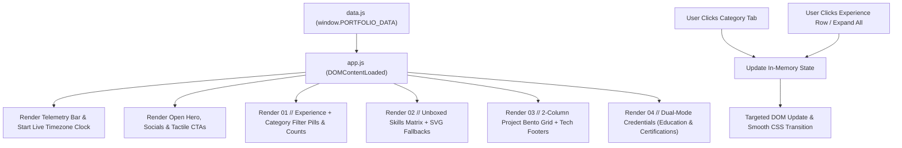

# Technical Architecture Specification (`architecture.md`)

## 1. Architecture Overview & Philosophy
This portfolio is built on a **Zero-Build, Data-Driven Static Architecture** consists of **4 flat files** (`index.html`, `style.css`, `data.js`, `app.js`).

1. **Zero Friction to Update**: 100% of the portfolio's text, links, experience categories, skills, 2-column projects, and education/certification credentials live inside `data.js` (`window.PORTFOLIO_DATA`). Updating any content requires editing only `data.js`.
2. **Zero Friction to Deploy & Run**: No `package.json`, no `node_modules`, no bundler, and no backend server. Works offline via direct double-click (`file://` protocol) and deploys in seconds via drag-and-drop or Git push to Cloudflare Pages, GitHub Pages, or Vercel.

> [!NOTE]
> **Intentional Architectural Omissions**
> Backend application servers, databases, REST/GraphQL APIs, authentication layers, and server-side secret managers are intentionally omitted to keep the architecture ultra-fast, free to host, and maintenance-free.

---

## 2. Folder Structure

```text
portf/
├── index.html          # Semantic HTML5 shell, typography links, and section mount points
├── style.css           # Smoked Jade & Whisper Glass tokens, 2-col project grid, animations
├── data.js             # SINGLE SOURCE OF TRUTH: Edit this file to update all portfolio data
├── app.js              # Vanilla ES6+ renderer, filter engine, accordion & clock controller
├── assets/
│   └── resume.pdf      # Local PDF resume
├── prd.md              # Product Requirements Document
├── design.md           # Design System Specification
└── architecture.md     # Technical Architecture Specification
```

---

## 3. Tech Stack

| Layer | Technology | Rationale |
| :--- | :--- | :--- |
| **Structure** | Semantic HTML5 | Clean document outline, SEO meta tags, and accessible ARIA mount containers. |
| **Styling** | Vanilla CSS3 | Native CSS Custom Properties, `backdrop-filter` whisper glassmorphism, CSS Grid `0fr/1fr` accordions, and responsive 2-column bento grid. |
| **Data Layer** | Plain JavaScript (`data.js`) | Exposes `window.PORTFOLIO_DATA`. Works synchronously on both `https://` hosts and local `file://` preview without CORS errors. |
| **UI Engine** | Vanilla JavaScript (ES6+) | Zero external runtime libraries. Renders DOM, calculates category counts, manages segmented tab filtering, toggles accordions, and updates the live telemetry clock. |
| **Icons & Fonts** | `Plus Jakarta Sans` + `JetBrains Mono` + Inline Stroke SVGs + SimpleIcons | Combines bespoke inline stroke SVGs (`1.75px` stroke) with official monochrome SimpleIcons brand marks and automatic inline fallback SVGs. |
| **Hosting** | Cloudflare Pages / GitHub Pages / Vercel | Global edge CDN with zero build configuration. |

---

## 4. Data Flow & Client-Side Rendering Lifecycle



---

## 5. Complete Data Contract (`data.js`)

Every section on the page maps directly to keys in `window.PORTFOLIO_DATA`:

- **`profile`**: `handle`, `timezone`, `city`, `name`, `role`, `status`, `bio` (array of paragraphs with optional inline location link), `actions` (`primary`, `secondary`, `resumeUrl`), and `socials` (`github`, `linkedin`, `mail`, `file-text`).
- **`experienceCategories`**: Array of `{ id, label }` tabs (`all`, `professional`, `organization`, `freelance`).
- **`experience`**: Array of `{ id, role, company, category, badgeLabel, icon, period, location, expandedByDefault, bullets }`.
- **`skills`**: Array of `{ category, items: [{ name, iconSlug, customIcon }] }`.
- **`projects`**: Array of `{ id, name, description, tag, stack, icon, url }` rendered into the 2-column bento grid.
- **`credentialCategories`**: Array of `{ id, label }` tabs (`all`, `education`, `certification`).
- **`credentials`**: Array of `{ id, type, badgeLabel, icon, title, subtitle, highlight, period, meta, url }`.

---

## 6. State Management (`app.js`)

```javascript
const state = {
  activeExpCategory: "all",       // "all" | "professional" | "organization" | "freelance"
  expandedExpIds: new Set(["exp-1"]), // First item expanded by default to demonstrate detail view
  activeCredCategory: "all"       // "all" | "education" | "certification"
};
```

---

## 7. Zero-Config Deployment Guide
1. **Cloudflare Pages / Netlify Drag-and-Drop**: Drag the `portf` folder directly into the dashboard upload box—live in 15 seconds.
2. **Git Push Deployment (Cloudflare / Vercel / GitHub Pages)**: Connect repository with **Build Command**: *(blank)* and **Output Directory**: `/`.
3. **Offline Local Preview**: Double-click `index.html` in File Explorer / Finder.

---

## 8. Defensive Rendering & Security
- **HTML Escaping**: All text fields from `data.js` pass through `escapeHtml()` before template rendering.
- **Icon Resilience**: If any `cdn.simpleicons.org` image fails to load (`onerror`), it automatically swaps to an inline custom SVG icon so broken image placeholders never appear.
- **External Link Safety**: All external links enforce `target="_blank" rel="noopener noreferrer"`.
