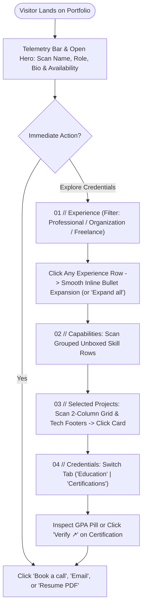

# Product Requirements Document (PRD): Personal Portfolio Website

## 1. Product Overview
A high-craft, single-page personal portfolio web application designed for maximum clarity, minimal vertical scrolling, and effortless content maintainability. While taking inspiration from the typographic discipline and breathing room of modern micro-portfolios (`abrory.pages.dev`), this product establishes its own unmistakable identity through the **"Smoked Jade & Whisper Glass"** design system and five signature structural innovations:
1. **Top Telemetry & Availability Rail**: A subtle editorial top bar displaying a live local time indicator, location, and an emerald availability pulse.
2. **Interactive Experience Rail with Category Filtering**: Replaces static horizontal/vertical lists with a filterable timeline (`Professional`, `Organization`, `Freelance`) featuring category count badges and individual inline expandable drawers with an active left emerald accent bar.
3. **2-Column Editorial Project Grid**: Displays selected projects in a compact 2-column asymmetric grid (instead of a long single-column list) with radial hover-glass spotlights and a monospace tech-stack micro-footer—cutting scroll height by ~40%.
4. **Unboxed Capability Matrix with Row Illumination**: Pairs clean category labels with inline monochrome brand/stroke icons that illuminate and lift subtly when scanning across a row.
5. **Dual-Mode Credential Ledger**: Separates **Formal Education** (with an emerald-tinted GPA pill) from **Professional Certifications** (with monospace Credential IDs and interactive `Verify ↗` pills) via segmented filter tabs.

All displayed content is rendered dynamically from a single declarative JavaScript file (`data.js`), allowing the portfolio owner to customize their role, bio, experiences, projects, and credentials in seconds without editing HTML or CSS.

---

## 2. Problem & Goal

### Problem Statement
1. **Scroll Fatigue & Unstructured Lists**: Traditional portfolios stack long, uncategorized lists of work history, organizational activities, projects, and certificates—forcing recruiters to scroll excessively.
2. **Clone Fatigue vs. Over-Designed "AI Slop"**: Copying existing minimalist templates verbatim lacks personal identity, while typical AI-generated portfolios overuse heavy neon boxes, gradients, and generic icons.
3. **Maintenance Friction**: Updating hard-coded HTML portfolios requires duplicating repetitive DOM markup for every new project or experience.

### Product Goals
- **Distinctive Yet Minimalist Identity**: Combine an open, breathable dark charcoal-jade canvas (`#0C100E`) with selective glassmorphism and signature layout touches so the site feels original, human-crafted, and senior-engineered.
- **Low-Scroll High-Density UX**: Keep the default page height within **~1.2x–1.4x desktop viewports** via the 2-column project grid and collapsible experience rows.
- **Clear Credential Separation**: Explicitly separate **Experience** types (`Professional`, `Organization`, `Freelance`) and **Credentials** (`Education` vs. `Certifications`) using interactive segmented tabs and semantic badges.
- **Zero-Build Data-Driven Updates**: Enable 100% of portfolio content to be updated via `data.js` with zero build tools, bundlers, or backend servers required.

---

## 3. Target Users

| User Persona | Primary Needs & Behavior | Key Portfolio Features Supporting Persona |
| :--- | :--- | :--- |
| **Technical Recruiters & Hiring Managers** | Scans a portfolio in **30–60 seconds** to verify role fit, real-world impact metrics, technical stack, and formal credentials. | Telemetry & Hero header, Segmented Filter Tabs with item counts (`Professional` vs. `Organization`), 2-column Project cards with tech-stack footers, and one-click Resume PDF access. |
| **Potential Clients & Collaborators** | Evaluates craft quality, past project outcomes, and communication channels to book a call or initiate an inquiry. | Interactive Project cards with live/repo links, clear availability status indicator, and tactile `Book a call` / `Email` actions. |
| **Portfolio Owner (Administrator)** | Needs a role-agnostic, future-proof structure where identity, roles, and entries can be updated rapidly before applying to different positions. | Single-source `data.js` configuration with automatic category filtering and defensive rendering. |

---

## 4. Core Features

### 4.1 Editorial Telemetry Bar & Open Hero Header
- **Top Telemetry Rail**: Subtle monospace header bar displaying owner handle/index (`00 // PORTFOLIO`), live local time (`UTC+7 · WIB`), and an active emerald availability indicator (`Available for select roles`).
- **Open Identity & Role Tagline**: Displays full name (`h1`) and customizable role/domain subtitle directly on the open canvas, paired with top-right borderless stroke SVG icon links (`GitHub`, `LinkedIn`, `Email`, `Resume PDF`).
- **Concise Executive Bio**: 2 short paragraphs highlighting location, core competencies, and practical systems built.
- **Tactile Conversion Actions**: Physical-feel primary mineral button (`Book a call` with calendar icon) and secondary smoked-jade glass button (`Email` with envelope icon).

### 4.2 Categorized Experience Section (Interactive Timeline Rail + Segmented Filter)
- **Section Header with Index & Segmented Filter**:
  - Displays monospace index `01 // Experience` on the left.
  - Right side houses a **Whisper-Glass Segmented Pill Bar** (`Professional`, `Organization`, `Freelance`) with live item counts, plus an `Expand all / Collapse all` micro-toggle.
- **Interactive Experience Rows**:
  - Each row displays a bespoke `18px` stroke role icon, **Role Title**, **Company/Organization Name**, a color-coded **Category Pill** (`Pro`, `Org`, `Freelance`), and tabular date range.
  - Clicking any individual row smoothly toggles its inline drawer (`0fr -> 1fr` CSS Grid transition) revealing location metadata and 2–4 impact bullet points, highlighted by a glowing `2px` emerald vertical indicator bar on the left edge.

### 4.3 Categorized Skills Matrix (Unboxed Capability Rows with Hover Illumination)
- **Section Header**: `02 // Technical Capabilities`.
- **Unboxed 2-Column Matrix**: Organizes technologies into clean rows (`Language`, `Frontend`, `Backend`, `AI / ML`, `Data`, `Infrastructure & Tools`).
- **Inline Brand & Domain Icons**: Each skill pairs a `14px` monochrome brand icon (`SimpleIcons`) or custom domain stroke SVG with plain text—flowing naturally without cluttered pill boxes around every skill. Hovering a row subtly illuminates the category label in emerald and brings its icons to full contrast.

### 4.4 Selected Projects Showcase (2-Column Editorial Bento Grid)
- **Section Header**: `03 // Selected Projects` on the left; `All repositories ↗` link on the right.
- **2-Column Asymmetric Grid**: Displays projects in a 2-column grid on desktop (`1` column on mobile) to maximize visual impact while minimizing vertical scroll height.
- **Hover-Awakened Whisper Glass Cards**:
  - Bordered by a whisper-quiet hairline (`1px solid rgba(255, 255, 255, 0.05)`) at rest; hovering awakens a frosted smoked-jade glass surface, radial cursor spotlight, and emerald border glint.
  - Contains: Domain stroke icon in a soft icon well + domain tag & `↗` arrow at top; Bold project title + concise metric description in middle; Monospace tech-stack micro-footer (`Python · GRU · React`) at bottom.

### 4.5 Separated Education & Certifications Section (Dual-Mode Credential Ledger)
- **Section Header**: `04 // Education & Certifications` on the left; **Segmented Filter Pills** (`Education`, `Certifications`) on the right.
- **Distinct Credential Row Anatomy**:
  - **Formal Education**: Mortarboard stroke icon, Institution Name, Degree/Major, an inline **Emerald-Tinted GPA Pill** (`GPA 3.86 / 4.00`), and right-aligned study years + city.
  - **Certifications & Licenses**: Verified Shield-Check stroke icon, Certification Title, Issuing Organization + Monospace Credential ID (`ID: TF-2025-8841`), issue year, and an interactive **`Verify ↗`** pill badge.

---

## 5. User Flow

---

## 6. Functional Requirements

| ID | Feature Area | Requirement Description | Priority |
| :--- | :--- | :--- | :--- |
| **FR-01** | **Data-Driven Rendering** | All portfolio sections (Telemetry, Hero, Socials, Experience, Skills, Projects, Education & Certifications) MUST render dynamically from `window.PORTFOLIO_DATA` in `data.js`. | P0 |
| **FR-02** | **Experience Categorization & Counts** | The Experience section MUST provide segmented filter tabs (`Professional`, `Organization`, `Freelance`) with item counts and render a semantic category pill on each entry. | P0 |
| **FR-03** | **Individual & Bulk Experience Accordion** | Clicking an individual experience row MUST toggle its detailed bullet points inline (`aria-expanded="true/false"`), accompanied by an `Expand all / Collapse all` section action. | P0 |
| **FR-04** | **2-Column Project Grid with Tech Footer** | Selected Projects MUST render in a responsive 2-column grid on desktop (`1` column on mobile), displaying domain icon, title, outcome description, category tag, and tech stack list. | P0 |
| **FR-05** | **Education & Certification Separation** | The Credentials section MUST allow filtering between `Education` and `Certifications`, rendering distinct visual badges (GPA pill for Education; Credential ID + `Verify ↗` link for Certifications). | P0 |
| **FR-06** | **Categorized Unboxed Skills** | The Skills section MUST group skills by category label on the left and render icon-plus-text items on the right with custom SVG fallbacks. | P1 |
| **FR-07** | **Live Telemetry Clock & Empty Fallbacks** | The top telemetry rail MUST display the owner's configured timezone/time cleanly, and any empty filter category MUST degrade gracefully without console errors. | P1 |

---

## 7. Non-Functional Requirements

- **Performance & Load Speed**:
  - First Contentful Paint (FCP) < `0.8s`; zero external JS framework dependencies.
- **Scroll Efficiency (Low-Scroll Ergonomics)**:
  - With experience rows in their default collapsed state, the entire page MUST fit within **~1.2x to 1.4x desktop viewport height** (`1080p`).
- **Zero-Build Portability**:
  - Works directly via local `file://` double-click or static deployment to Cloudflare Pages, GitHub Pages, or Vercel with zero build step.
- **Accessibility (a11y)**:
  - WCAG 2.1 AA contrast compliance on dark smoked-jade surfaces, full keyboard navigation (`Tab`, `Enter`, `Space`), and full support for `prefers-reduced-motion: reduce`.

---

## 8. Scope & Out of Scope

### In Scope
- Single-page responsive portfolio with the **Smoked Jade & Whisper Glass** dark theme and signature editorial layout touches.
- Role-agnostic dummy dataset in `data.js` ready for effortless customization.
- Segmented category filtering + badges for **Experience** and **Education & Certifications**.
- 2-column project showcase with hover spotlight and tech stack footers.

### Out of Scope (Intentionally Omitted)
- **GitHub Contribution Activity Calendar**: Omitted to avoid visual clutter and third-party API latency.
- **Light/Dark Theme Switcher**: Dedicated 100% to the signature Dark Smoked Jade aesthetic.
- **Backend Server, Database, or Admin CMS**: Replaced by the zero-cost `data.js` static file architecture.

---

## 9. Success Criteria
1. **Distinctive Visual Identity**: Immediately recognizable as an original, high-craft portfolio—sharing the clean readability of the reference without looking like a 1:1 clone.
2. **30-Second Recruiter Scan**: Visitors can filter *Professional* vs. *Organizational* experience, inspect 2-column project metrics, and verify *Education* vs. *Certifications* within 30 seconds.
3. **60-Second Content Update**: Adding or modifying any portfolio entry requires editing only `data.js` and takes under 60 seconds.
